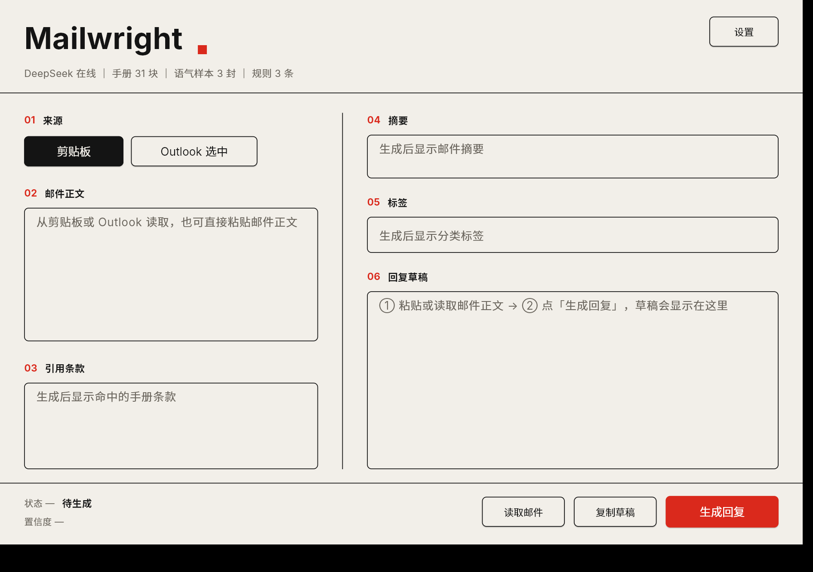

# Mailwright

由 tktk05410 开发的《人类世界》邮件插件。该插件以《work》这款游戏为灵感而设计，直接集成在游戏的电脑系统中。
它能做什么：读取邮件正文，结合企业手册条款（RAG）与历史邮件语气，生成可直接使用的中文回复草稿。



`Python 3.13` · `Flet 1.0.4` · `DeepSeek / 任意 OpenAI 兼容接口` · `BAAI/bge-small-zh-v1.5` · `BM25 + jieba`

---

## 它解决什么问题

客服回信上有三件反复出现的麻烦事：

1. **重复劳动**——大量邮件是同一类问题，回答有套路可循；
2. **没有依据**——新员工记不住公司手册里的规定，答复靠临场回忆；
3. **风格漂移**——每个人写邮件的称呼、措辞、落款都不一样，客户体验不稳定。

Mailwright 把这三件事收进一个桌面工作台：读入一封邮件 → 检索相关条款与历史语气 → 生成一份带引用、可核对的回复草稿。**它只产草稿，不发送。**

## 功能

- **邮件来源**：剪贴板 / Outlook 选中邮件（COM 调用，需 Outlook 正在运行）
- **分类摘要**：标签、是否需回复、一句话摘要、置信度
- **条款检索**：BM25 + 向量双路召回，RRF 名次融合；相似度阈值可在 `config.json` 调整
- **多手册管理**：支持上传多份 md/txt/pdf/docx 手册，启用开关在检索期过滤、即时生效
- **语气模仿**：内置语气样本，可导入 Outlook 已发送邮件（落盘前对邮箱地址脱敏，仅存本机）
- **规则约束**：自定义回复规则注入 prompt（限 20 条、自动去重，超出时界面提示）
- **引用校验**：模型引用了不存在的条款号时立即告警；命中条款全文在界面可见
- **离线降级**：未配置 API Key 或调用失败时，降级为本地演示结果，状态栏明确标注「离线演示 / 已降级」
- **界面**：浅色 / 深色切换并记忆，窗口可缩放最大化、布局自适应（不做整页缩放，文字始终清晰），启动先显示加载页

## 快速开始

环境要求：Windows 10/11（Outlook 来源依赖 pywin32 的 COM 接口，仅 Windows 可用）、Python 3.13、可访问的 LLM API。

```powershell
git clone https://github.com/tktk05410/mailwright.git
cd mailwright
python -m venv .venv
.\.venv\Scripts\pip install -r requirements.txt
.\.venv\Scripts\python app.py
```

- 窗口默认 1080×760。
- 首次启动需加载嵌入模型（约 90 MB，数秒到 10 秒，界面会先显示加载页）；之后命中 `data/index/` 缓存会明显加快。
- 未配置 API Key 也能启动，以离线演示模式跑通完整流程。
- 国内网络可加镜像：`pip install -r requirements.txt -i https://pypi.tuna.tsinghua.edu.cn/simple`；模型默认走 `hf-mirror.com` 下载。

## 配置

复制 `.env.example` 为 `.env`，或在应用「设置 → 模型 API」中填写（保存前自动做连通性测试，失败不落盘）：

```ini
LLM_API_KEY=sk-xxx
LLM_BASE_URL=https://api.deepseek.com
LLM_MODEL=deepseek-chat
```

支持任意 OpenAI 兼容接口（OpenAI、Moonshot、智谱 GLM、通义千问、SiliconFlow 等），改这三行即可切换，无需改代码。

## 工作原理

```text
邮件（剪贴板 / Outlook COM）
  └─ 预处理：HTML 转文本 → 去引用 → 去签名 → 长度截断
       ├─ 分类（LLM）：labels / need_reply / summary
       └─ 检索（RAG）
            ├─ BM25（jieba 分词）──┐
            └─ BGE 向量 ──────────┴─ RRF 名次融合 → 阈值过滤
                                       → top-5 条款 + top-3 语气样本
            └─ 起草（LLM）：规则 + 条款 + 语气样本 + 原邮件 → 草稿
                 └─ 引用校验：cited_clauses 是否真实存在于命中条款
```

| 模块 | 职责 |
|---|---|
| `adapters/` | 邮件来源适配：剪贴板、Outlook COM |
| `preprocess/` | 邮件清洗（HTML、引用、签名、信封解析）、手册切块 |
| `rag/` | 双路索引、RRF 融合检索、索引持久化与缓存校验 |
| `agent/` | 固定流水线编排、prompt 模板、工具层 |
| `core/` | LLM 客户端（重试、JSON 容错、离线降级）、数据模型、日志 |
| `app.py` | Flet 界面入口与装配 |

编排是**确定性的固定流水线**，不是自由 Agent 循环：`classify_email → search_handbook → search_style_samples → draft_reply`，流程可预期、成本可控、出问题只需修一处。

## 检索设计

两路召回的结果不做分数加权，只做**名次融合**（RRF）：

```text
score(d) = Σ 1 / (60 + rank_i(d))
```

两路分数的量纲不同（BM25 无上界、余弦相似度 0~1），直接相加需要额外归一化和调参；名次天然可比。这个公式还带来一个有用的性质：单路榜首分值为 `1/61 ≈ 0.0164`，把下限设在 `0.02` 就等价于**要求两路同时命中**，只沾一边的干扰项自动被挡掉。

实践中又发现一个反例：用户问「加急件最晚几点交件」，手册写的是「次晨达、18 点前揽收」，两路只命中一路，好条款被误杀。因此对**向量路**单独开了兜底（只对向量路，因为 BM25 分数没有可标定的门槛，相似度有）。

### 检索参数（`config.json`）

| 键 | 默认 | 说明 |
|---|---|---|
| `top_k` | 5 | 手册条款召回条数 |
| `min_cos` | 0.48 | 向量相似度阈值（bge 模型） |
| `min_cos_hash` | 0.10 | 模型不可用、退化为哈希向量时的阈值 |
| `min_rrf` | 0.02 | 融合分下限；单路榜首 `1/(60+1)≈0.0164`，因此 0.02 等价于「两路都要命中」 |
| `vector_fallback` | true | 手册条款的「向量单路兜底」：语义相似度达标但 BM25 未命中时也保留；哈希模式下自动关闭 |
| `temperature` / `max_tokens` | 0.3 / 1024 | 生成参数 |

索引缓存会比对**嵌入模型、切块管线版本、全部源文件的 `(修改时间, 大小)`**，任一不一致自动重建；也可以随时删除 `data/index/` 强制重建。

## 项目结构

```text
adapters/       数据来源（剪贴板、Outlook COM）
preprocess/     邮件清洗与手册切块
rag/            索引（BM25 + 向量）、融合检索、持久化
agent/          编排、prompt、工具层
core/           LLM 客户端、数据模型、日志
assets/fonts/   Inter 与 Noto Sans SC 字体
data/handbook/  手册文件（md/txt/pdf/docx），含演示手册
data/styles/    语气样本（samples.json 为虚构演示数据）
data/index/     索引缓存（首次运行自动生成，可随时删除）
docs/           README 配图
config.json     检索阈值、温度、规则等参数
```

## 已知限制

- **长段落截断**：切块只在段落粒度拼接，单段超过 500 字时不做二次切分，超出模型 512 token 上限的部分会被静默截断，段落尾部可能检索不到。
- **无重排**：融合后直接取 top-k，没有 cross-encoder 重排环节。
- **全量重建**：手册或模型变化时重建整个索引，未做增量更新。
- **平台限制**：Outlook 来源依赖 Windows COM，非 Windows 环境只能走剪贴板。
- **置信度未校准**：`confidence` 是模型自评，不是经过标定的概率，只用于界面提示。

## 隐私

- `.env`（含 API Key）、导入的真实邮件、索引缓存均已加入 `.gitignore`，不入库。
- 导入语气样本时，邮箱地址自动替换为 `***@***`。
- 仅检索命中的几条条款随请求发送给模型；手册原文与索引只保存在本机。
- 应用只生成草稿，不提供发送动作。

## 致谢

界面基于 [Flet](https://flet.dev/)，向量模型为智源 [BAAI/bge-small-zh-v1.5](https://huggingface.co/BAAI/bge-small-zh-v1.5)，关键词检索使用 [jieba](https://github.com/fxsjy/jieba) 与 [rank_bm25](https://github.com/dorianbrown/rank_bm25)，生成调用 DeepSeek API。

## 许可

本仓库为课程作业成果，未附带开源许可（All rights reserved）。如需引用或二次使用，请先联系作者。
